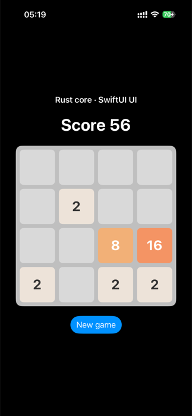
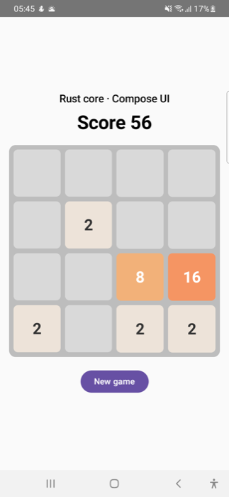

# rust-core-demo

A 2048 game whose rules live in **one Rust crate** ([`game_core`](game_core/src/lib.rs)), exposed to both apps through [UniFFI](https://mozilla.github.io/uniffi-rs/). The UIs only render state and forward swipes.

| iOS (SwiftUI) | Android (Jetpack Compose) |
| :---: | :---: |
|  |  |

Same moves on both devices produce the same board and score (56), because both call the same Rust `Game`.

## Layout

| Path | What |
| --- | --- |
| `game_core/` | Rust core: `Game::new(seed)`, `slide(dir)`, `cells()`, `score()`, `is_over()` |
| `ios/` | SwiftUI app (XcodeGen `project.yml`), links `libgame_core.a` |
| `android/` | Compose app, loads `libgame_core.so` |
| `build-ios.sh`, `build-android.sh` | Build the Rust library and regenerate bindings (`dev` or `release`) |

## Build

```bash
./build-ios.sh dev       # then open ios/GameDemo.xcodeproj and run
./build-android.sh dev   # then build android/ with Gradle
```

Needs Rust (with the iOS/Android targets), Xcode, and the Android SDK + NDK.
